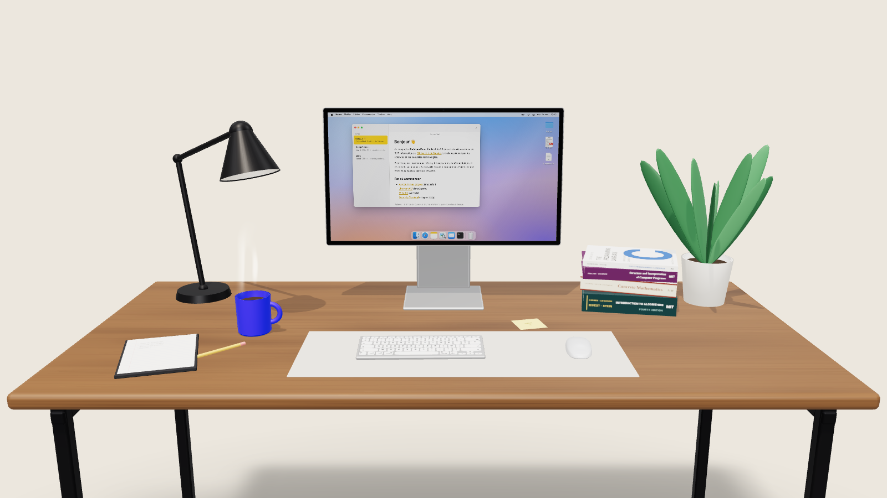

# portfolio

Source code of my personal portfolio: an interactive 3D desk built with Three.js and Next.js, with a small explorable operating system on the computer screen.

Inspired by the concept of [Henry Heffernan's portfolio](https://github.com/henryjeff/portfolio-website); all code and 3D models here are original.



## 🚀 Features

- **Bureau en 3D (Three.js)** : un bureau modélisé entièrement en code (aucun modèle à télécharger), avec un écran 27" façon Studio Display XDR (pied réglable en hauteur), un clavier façon Magic Keyboard (AZERTY, légendes sur les touches) et une souris façon Magic Mouse, une lampe d'architecte, une plante, une tasse de café, des livres et un carnet.
- **Caméra libre** : on tourne à 360° autour du bureau (glisser) et on zoome / dézoome (molette ou pincement), le bureau restant toujours au centre de l'écran et sans jamais pouvoir passer sous le sol. En sortant de l'écran, on retrouve l'angle où l'on était.
- **Écran de chargement** façon vraie session de terminal (zsh, `npm run start`, logs Next.js) : l'étape de compilation attend le vrai chargement de la scène 3D, puis on valide la dernière commande avec Entrée ou un clic.
- **khémaraOS** : en cliquant sur l'écran, la caméra zoome et on utilise un petit OS inspiré de macOS, rendu sur l'écran via `CSS3DRenderer` : barre des menus, Dock avec effet de loupe et rebond au lancement, fenêtres déplaçables et redimensionnables, icônes sur le bureau.
- **Applications** : Finder (projets, documents, applications, corbeille), Safari (pages des projets), Notes (à propos, compétences, liens), Aperçu (CV), Mail (contact), Terminal (`help`, `ls`, `cat`, `open`, `lampe`…), et la fenêtre « À propos de ce Mac ».
- **Lampe de bureau** : elle s'allume et s'éteint d'un clic et éclaire la tasse et le carnet.
- **Mobile** : sur petit écran, l'ordinateur s'ouvre en plein écran avec une mise en page adaptée.
- **Accessible et indexable** : contenu texte caché pour les lecteurs d'écran et les moteurs de recherche, pages d'articles statiques (`/blog/[slug]`), repli 2D si WebGL n'est pas disponible, respect de `prefers-reduced-motion`.

## 🛠️ Tech Stack

- **Framework** : [Next.js](https://nextjs.org/) (React 19, App Router, SSG)
- **3D** : [Three.js](https://threejs.org/) (WebGL + CSS3DRenderer)
- **Styles** : [Tailwind CSS](https://tailwindcss.com/)
- **Typographie** : Inter & Geist Mono
- **Langage** : [TypeScript](https://www.typescriptlang.org/)

## 🏗️ Project Structure

- `/app` : routes, layout et styles globaux.
- `/lib/scene` : la scène Three.js (`DeskScene`), le matériel (`hardware.ts`), les autres objets, les textures générées et les animations de caméra.
- `/components/experience` : intégration React de la scène et écran de chargement.
- `/components/os` : *khémaraOS* (barre des menus, Dock, fenêtres, applications dans `apps/`).
- `/content` : articles et projets en Markdown.
- `/public` : icônes, images et CV.

## 💻 Getting Started

1. Clone the repository:
```bash
git clone https://github.com/pkhemae/portfolio.git
cd portfolio
```

2. Install dependencies:
```bash
npm install
```

3. Start the development server:
```bash
npm run dev
```

4. Open [http://localhost:3000](http://localhost:3000) in your browser.

## 📄 License

MIT © [Khémara Parc](https://github.com/pkhemae)
